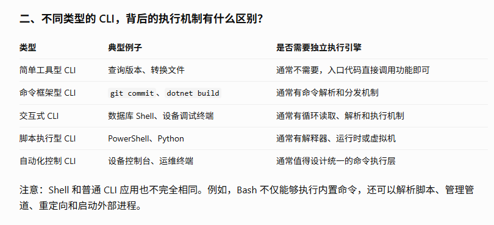

# 功能设计

## 1 模拟上位系统给下位设备（系统）发送指令。
## 2 模拟下位设备（系统）给上位系统发送数据。
## 3 监听上下位系统/设备的通讯状态、通讯数据。
## 4 编排上下位系统/设备的通讯流程，模拟上下位系统/设备的通讯逻辑。
## 5 编排的通讯流程可以通过配置文件进行配置，支持多种通讯协议。
## 6 支持MCP（Message Control Protocol）协议的通讯流程编排。

# 系统实现设计思路

包括：  
（1）Command Engine模块，用于执行单一指令；  
（2）未来升级为Advanced Command Engine模块，可执行包含多指令的，带有适当控制逻辑的命令脚本；  
（3）开发有配套的MCP实现，支持AI接入使用模拟器；  
（4）提供一个UI界面可控制指令执行，同时指令执行需要对应有UI变换反馈到UI，因此要求UI出发执行指令，和指令执行后UI的反馈是分离的，执行指令是独立的，之后执行后的是独立的，是通过Engine反馈到UI界面的。  
（5）界面以类似vscode 这种多文档类型界面开发。所有指令均可在菜单栏找到。  
（6）可读取指令文件脚本，加载到engine中，engine可执行语法正确的指令脚本。  
（7）可选择某一段指令日志，将对应的指令作为脚本导出到文件。  
（8）可编辑一个指令集文件，以方便单指令调试。  
（9）内置基础本地AI模型，可在理解语义的基础上，结合MCP功能，编排指令。  
（10）

Command Server模块，用于接收上位系统发送的指令；Command Client模块，用于向下位设备发送指令；Data Server模块，用于接收下位设备发送的数据；Data Client模块，用于向上位系统发送数据；Protocol Handler模块，用于处理不同通讯协议的解析和封装。
